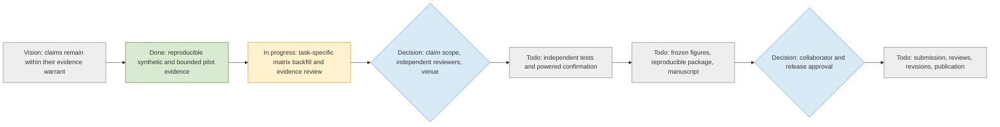

# Yi handoff roadmap: ARC Lean, SEED, and scientific closure

Prepared 2026-11-21 for Hisa. This is Yi Cao's engineering/evidence handoff. Agent checks below do not replace human scientific approval. Workload labels are relative effort, not delivery dates: S = focused review or edit; M = several coordinated tasks; L = a new scientific campaign.

Commands and unqualified experiment/registry paths below are relative to **ARC-CM-TMLR**. NPJ and SEED entries name their separate repositories.

| Step / status | Owner and dependency | Acceptance / next entry | Effort |
|---|---|---|---|
| Repository/evidence separation — done | Yi, agent-assisted inventory | `SPEC.md`; CM main `7794766`; SEED main `8acf435`; NPJ main `dc72ab5`; CM PR #12 merged | S |
| E1–E5 execution packaging — done with scientific limits | Yi execution; GPT-6 Luna assisted scoring | `../../../experiments/confirmatory/E1_E5_INTEGRATED_REPORT.md`; task manifests. E1–E3 synthetic; E4 readiness only; E5 descriptive | S |
| Quantitative matrix — in progress | Yi; active campaign worktree and existing automation `arc` | `registry/inputs/matrix_common_cells.csv`: frozen 134 measured cells, exact units; 768 rows. Run `python3 docs/handoff/2026-11-21/registry/build_registry.py`. Follow original worker at `/Users/yicao/Documents/ARC/worktrees/arc-cm-matrix-backfill-20261120/experiments/matrix_backfill_20261120`; do not rerun failed protocols implicitly | M |
| Claim and journal scope — decision | Hisa / scientific lead to confirm; Yi prepares exact claim map | Decide bounded methods paper vs broader scientific protocol claim. TMLR, Nature Communications and npj names are separate historical/planned routes, not journal acceptance or current submission proof | S |
| E1 capability / formalization fidelity — todo | Yi builds comparison; independent domain/formal reviewers to be named | Human contract/fidelity review; Autoformalize-then-Lean; licensed/implementation-verified baselines; distinguish actual kernel execution and abstract receipts | M |
| E2/E3 independent validation — todo | Yi implementation; two independent human reviewers for E2; semantic/domain reviewers for E3 | Freeze amendments before new outputs; retain failures and family denominators; new generator/real tasks before generalization. New typed 8B decoder cannot estimate pure model-size effect | M–L |
| E4 historical replay — todo / input blocked | Data custodian and domain owner to be named; Yi adapter | Timestamped pre-states, pre-outcome requests, interventions and non-intervention windows recovered and reviewed; otherwise drop recall/precision claim. Entry: `experiments/confirmatory/e4/EVIDENCE_REPORT.md` | L |
| E5 powered confirmation — todo | Yi protocol/engineering; independent statistician/domain reviewer to be named | Fresh preregistration, non-degenerate power gate, independent families, valid terminal-claim coverage, matched budgets and LLM acquisition arm. Existing Block B zero coverage cannot identify an integration bottleneck | L |
| Real scientific anchors — todo | Yi prepares RP-001 trace; independent fidelity reviewer; NPJ scientific owner to confirm | RP-001 source-to-theorem mapping review; independent real-paper cohorts with outcome sealing. NPJ: finish polymer empirical closure and common three-case gates. Entry: NPJ `docs/claim_evidence_ledger.md` | L |
| SEED route — decision then todo | Yi's scope is formal/evidence contribution (existing PR #78); SEED lead and independent reviewer own scientific approvals | Preserve `yicao` and dirty evidence. R37 only after distinct reviewer/protocol-owner signatures and sealed-data contract. Do not require Yi to own Hisa's production/manuscript or Amanda's domain/GP sign-off | M–L |
| Figures and reproducibility — todo | Yi prepares; collaborator reproduces independently | Freeze SQL inputs/hashes, claim-to-figure/table links, model/Lean pins, all failure denominators; rebuild from clean checkout; remove identity leaks from anonymous package; source-license/release approval | M |
| Manuscript and submission gate — todo | Hisa/scientific lead confirms ownership and journal; Yi supplies scoped methods/report/PR | Match every abstract/conclusion claim to accepted evidence; disclose related papers/overlap, limitations and contribution roles; all collaborators approve exact version; archive DOI/release and approved anonymous payload before submission | M |
| Review to publication — todo | Corresponding author / lead to confirm; Yi supports scoped revisions | Track editor/reviewer decisions, preregister necessary new tests, update claim ledger and figures, obtain final coauthor approval, submit revision and accepted reproducibility deposit | M–L |

No future research campaign or actual submission is asserted complete. No email or Slack message was sent.
